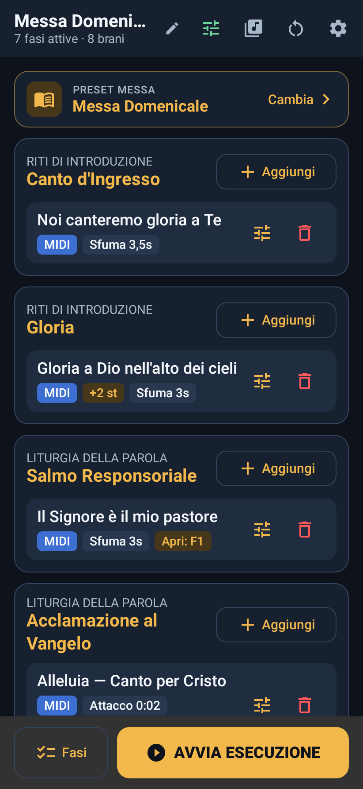
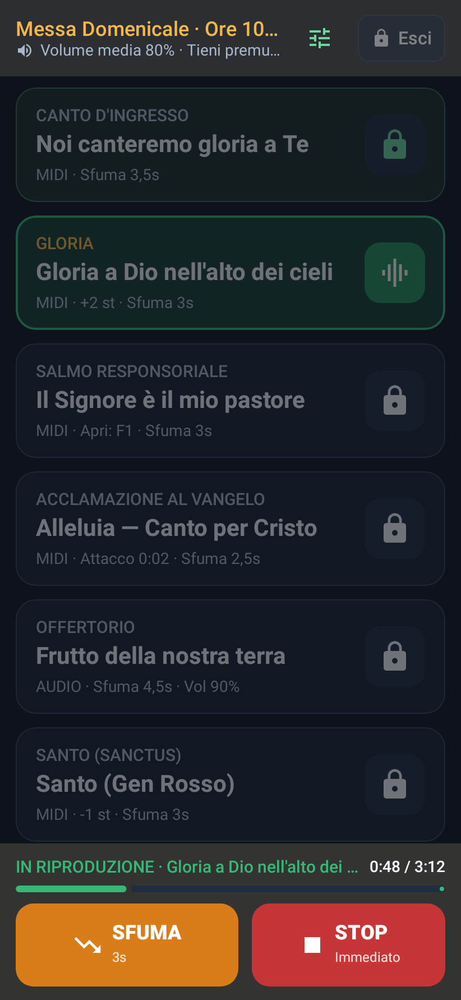
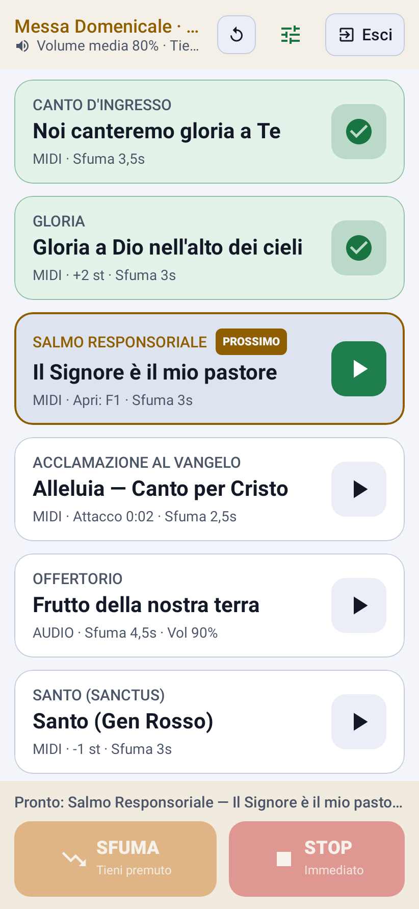
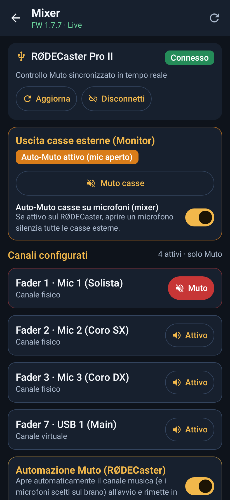
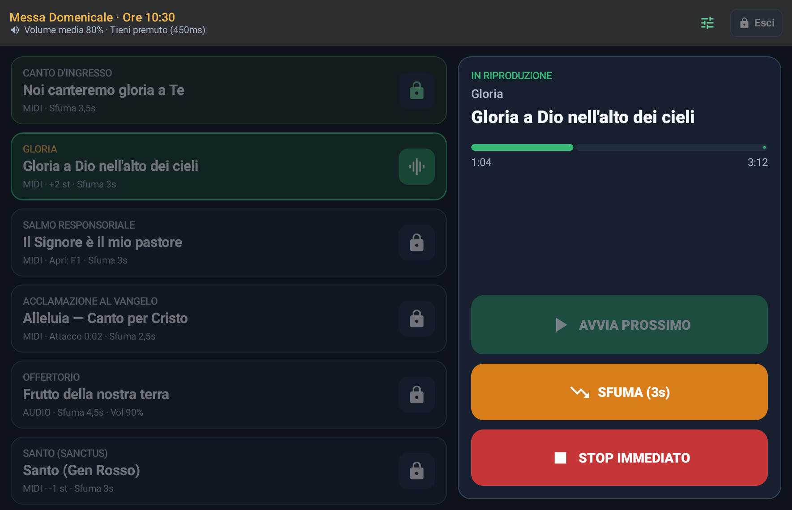
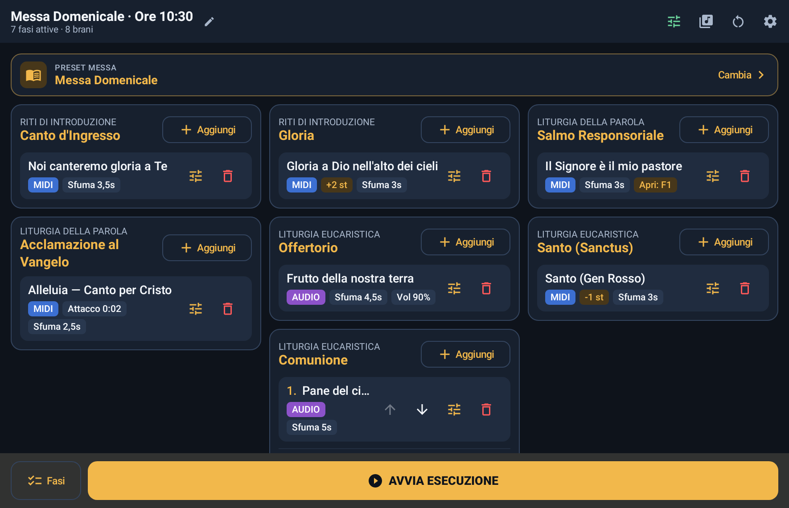

# Coro — App Android per il Coro Parrocchiale

Applicazione Android touch (Kotlin + Jetpack Compose + Material 3) progettata per programmare ed eseguire le basi musicali (**MIDI**, **KAR** e **MP3/WAV**) durante la Santa Messa, sostituendo la postazione PC con vanBasco.

## Schermate dell'applicazione

### Modalità Mobile (Smartphone)

| Programmazione Messa | Esecuzione Live (Scuro) | Esecuzione Live (Chiaro) | Mixer RØDECaster Pro II |
| :---: | :---: | :---: | :---: |
|  |  |  |  |

### Modalità Tablet ed E-Ink (Console a due pannelli e Griglia multi-colonna)

| Console Esecuzione Live (Scaletta + Regia laterale) | Programmazione Messa (Griglia multi-colonna) |
| :---: | :---: |
|  |  |

## Funzionalità principali
- **Programmazione Messa e Preset Liturgici:**
  - Catalogo completo delle 18 fasi del Rito Romano (Messale Italiano) attivabili/disattivabili con un tocco + fasi personalizzate; ogni fase supporta più brani avviati manualmente (es. Comunione).
  - **13 preset liturgici pronti all'uso** divisi per categoria: *Ordinarie* (Feriale, Domenicale, Solenne), *Tempi Forti* (Avvento/Quaresima, Natale con Kalenda e Bacio del Bambino, Domenica delle Palme, Pentecoste/Corpus Domini), *Triduo Pasquale* (Giovedì Santo, Venerdì Santo, Veglia Pasquale, Domenica di Pasqua) e *Celebrazioni* (Matrimonio, Esequie/Funerale).
  - **Preset personalizzati salvabili:** salva la scaletta attuale (fasi e brani con tutte le relative impostazioni) per riutilizzarla con un tocco.
- **Libreria da cartella sul dispositivo:** selezione tramite Android Storage Access Framework (cartella copiata da PC via USB/Drive, incluse sottocartelle), ricerca rapida e filtri. Include 9 brani di prova pronti all'uso.
- **Impostazioni per singolo brano salvate e sincronizzate:**
  - Punto di attacco (`mm:ss`) con anteprima audio e cattura al volo (*"Imposta punto di attacco qui"*)
  - Durata sfumatura (`0,5–15 s`)
  - Cambio tonalità (`-12..+12` semitoni; sui MIDI preserva intatto il canale 10 delle percussioni)
  - Volume relativo brano (`20%–150%`)
  - Canali microfonici extra da aprire sul mixer per quel brano (es. solista/ambone)
- **Console Esecuzione Live (Smartphone, Tablet, E-Ink e Desktop):**
  - Interfaccia adattiva edge-to-edge con **Tema Scuro**, **Tema Chiaro** ad alto contrasto o **Sistema**, ottimizzata anche per caratteri grandi e display e-ink (es. BOOX Tab Mini C), schermo sempre acceso, indicatore volume multimediale e scorciatoie da tastiera (`Spazio`, `Shift+Spazio`, `Ctrl+P`, `Ctrl+N`, `Ctrl+O`, `Ctrl+F`).
  - **Protezione tocchi accidentali:** pressione prolungata in tempo reale (default `450 ms`, regolabile `300–1200 ms` con area test) per Avvio, Sfuma, Stop immediato e Uscita; segnatura immediata del brano eseguito su Sfuma/Stop con indicazione automatica del brano successivo (`PROSSIMO`).
- **Controllo Mixer RØDECaster Pro II e Routing Audio:**
  - Integrazione USB HID nativa con **RØDECaster Pro II** (connessione automatica su porta USB 1, rilevamento automatico del canale musica `USB 1 (Main)`, automazione Muto/Unmute a inizio e fine brano e protezione uscita casse Monitor).
  - Selettore dedicato per forzare l'uscita audio su **Bluetooth**, **USB Audio**, **Altoparlante** o **Automatica**.
- **Motore Audio integrato 100% offline:**
  - **MIDI (`.mid`, `.midi`, `.kar`):** sintetizzatore nativo **FluidSynth v2.6.2** (256 voci, interpolazione di 4° ordine, riverbero e chorus caldi, frequenza nativa 48 kHz, cache RAM del banco suoni per avvio immediato, limiter morbido $C^1$ anti-distorsione) + parser `tml.h`. Supporta banchi suoni **`.sf2`** e **`.sf3`** (con `TimGM6mb.sf2` integrato e link diretti nelle Impostazioni per scaricare banchi gratuiti come *MuseScore General*, *FluidR3 GM* e *GeneralUser GS*).
  - **Audio (`.mp3`, `.wav`, `.m4a`, `.ogg`, `.flac`):** **AndroidX Media3 ExoPlayer**.
  - Micro-rampa anti-click sullo stop immediato e sfumatura fluida pensata per l'impianto audio della chiesa.

## Aprire, compilare e debuggare in Android Studio
1. Apri la cartella del progetto in **Android Studio** (*File → Open*).
2. Verifica in *Settings → Languages & Frameworks → Android SDK → SDK Tools* che sia installato **NDK (Side by side)** (necessario per il modulo nativo `coro_midi`). Alla prima compilazione Gradle scarica e mette in cache automaticamente le librerie Android precompilate di **FluidSynth v2.6.2**.
3. Collega uno smartphone o tablet Android via USB con **Debug USB** attivo nelle *Opzioni sviluppatore*.
4. Premi **Run (`Shift+F10`)** o **Debug (`Shift+F9`)**.

## Compilazione da terminale
```powershell
.\gradlew.bat testDebugUnitTest assembleRelease
```
L'APK di release viene generato in `app\build\outputs\apk\release\app-release.apk`.

## Licenza e componenti di terze parti
- Il codice sorgente di **Coro** è rilasciato sotto licenza **MIT** (vedi [LICENSE](LICENSE)).
- Componenti di terze parti integrati:
  - **FluidSynth** v2.6.2 (linkato dinamicamente come libreria condivisa `.so`) — licenza **LGPL-2.1**.
  - **TinyMidiLoader** (`tml.h`) — licenza **MIT**.
  - **TimGM6mb.sf2** (banco suoni General MIDI predefinito) — distribuito sotto licenza **GPL-2.0**.

## Documentazione
- Specifica dei requisiti funzionali: [docs/REQUISITI_FUNZIONALI.md](docs/REQUISITI_FUNZIONALI.md)
